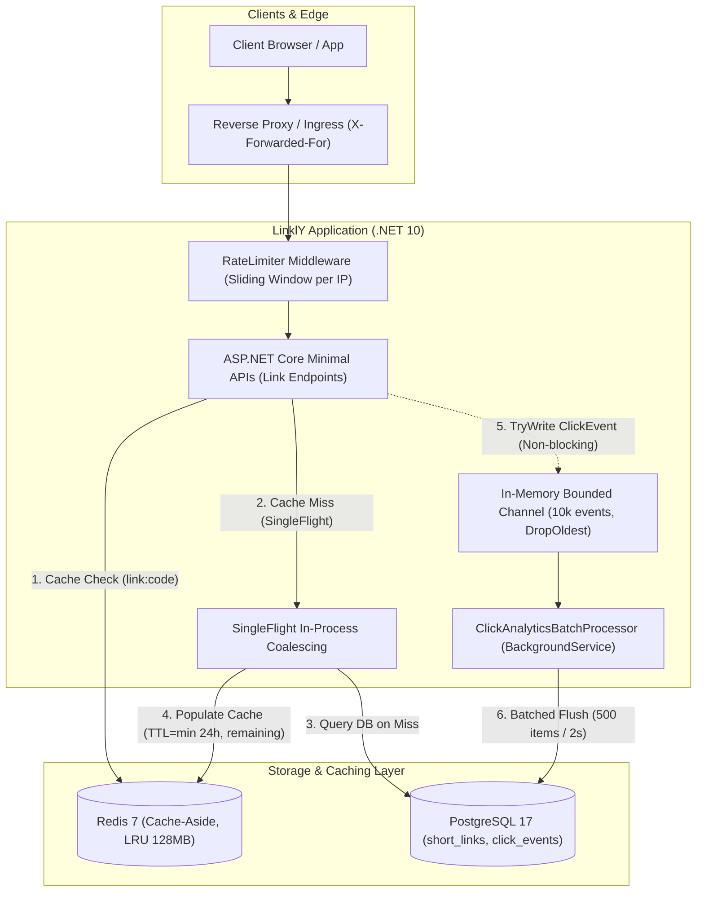

# LinklY - High-Performance URL Shortener (.NET 10 Minimal APIs)

A production-grade, high-throughput URL shortening service built with **.NET 10**, **ASP.NET Core Minimal APIs**, **PostgreSQL**, **Redis**, and **Entity Framework Core**.

---

## Architecture Overview



---

## Features

- **High-Throughput Redirects (`GET /{code}`)**:
  - Redis cache-aside with 50ms async timeout, backoff circuit breaker, and automatic fallback to PostgreSQL.
  - In-process **SingleFlight** deduplication preventing cache stampedes under high concurrency.
  - Negative caching (60s TTL) preventing cache penetration for nonexistent codes.
  - Read-time expiration checks with `TimeProvider` returning `410 Gone` (cached links never resurrect expired URLs).
- **Asynchronous Click Analytics**:
  - Non-blocking writes to an in-memory bounded `Channel<ClickEvent>` (10,000 capacity, `DropOldest` with dropped clicks counter).
  - Background worker (`ClickAnalyticsBatchProcessor`) bulk-inserting events every 500 items or 2 seconds.
  - Graceful shutdown flush draining all buffered events to PostgreSQL.
  - Privacy by design: Referrer and UserAgent truncated to 200 chars; zero raw IP addresses stored.
  - Stats endpoint: `GET /api/links/{code}/stats` returning `totalClicks` and 30-day daily breakdown.
- **Custom Vanity Aliases & Expiration (`POST /api/links`)**:
  - Optional custom alias (3-30 chars, `[a-zA-Z0-9_-]`).
  - Reserved keywords rejection (`api`, `health`, `swagger`, `metrics`, etc.).
  - Uniqueness strictly enforced by PostgreSQL `UNIQUE INDEX` handling code `23505` $\rightarrow$ `409 Conflict` (no check-then-insert TOCTOU races).
  - Alias creation immediately busts negative cache entries.
  - Optional future expiration timestamp (`expiresAt`).
- **Rate Limiting & Proxy Forwarding**:
  - Built-in ASP.NET Core sliding window rate limiter: 20 req/min per IP on `POST /api/links`.
  - Emits RFC 7807 `ProblemDetails` with `429 Too Many Requests` and `Retry-After` header.
  - `ForwardedHeaders` configured for reverse proxy deployments.
  - Configurable rate limiting for redirects via `RateLimiting:Redirect:Enabled`.
- **Zero-Setup Testing**:
  - 62 tests across unit and integration test suites.
  - Integration tests run against disposable PostgreSQL and Redis containers via **Testcontainers**.
- **Observability**:
  - Structured logging with **Serilog**.
  - System metrics for cache hits, misses, errors, and dropped clicks exposed at `/internal/stats`.
  - Native `/health` check verifying database connectivity.

---

## Tech Stack

- **Framework**: .NET 10, C# 13, ASP.NET Core Minimal APIs
- **Database**: PostgreSQL 17 (Npgsql + EF Core)
- **Cache**: Redis 7 Alpine (StackExchange.Redis)
- **Testing**: xUnit, Testcontainers (PostgreSql & Redis), WebApplicationFactory
- **Observability**: System.Diagnostics.Metrics, Serilog
- **Load Testing**: Grafana k6

---

## Quick Start (Docker Compose)

The entire application, PostgreSQL database, and Redis cache run locally with a single command:

```bash
docker compose up --build -d
```

### Endpoints
- **API Base URL**: `http://localhost:5100`
- **Health Check**: `http://localhost:5100/health`
- **Internal Cache & Analytics Stats**: `http://localhost:5100/internal/stats`
- **PostgreSQL**: `localhost:5433` (db: `urlshortener`, user: `postgres`, password: `postgres`)
- **Redis**: `localhost:6380`

To stop and remove containers:
```bash
docker compose down -v
```

> 📖 **Commands Cheatsheet**: For a complete list of docker, curl, test, and migration commands, see [COMMANDS.md](COMMANDS.md).

---

## API Reference

### 1. Create Short Link
- **POST** `/api/links`
- **Headers**: `Content-Type: application/json`
- **Body**:
  ```json
  {
    "url": "https://github.com/dotnet/aspnetcore",
    "alias": "aspnet-core",
    "expiresAt": "2026-12-31T23:59:59Z"
  }
  ```
- **Responses**:
  - `201 Created`: Returns short URL metadata with `Location: /aspnet-core`.
  - `400 Bad Request`: Invalid URL format, invalid alias characters, or reserved alias.
  - `409 Conflict`: Alias already in use.
  - `429 Too Many Requests`: Client exceeded 20 requests/minute (includes `Retry-After` header).

### 2. Redirect to Original Link
- **GET** `/{code}`
- **Responses**:
  - `302 Found`: Redirects to target destination (`Location: <OriginalUrl>`).
  - `404 Not Found`: Link code does not exist.
  - `410 Gone`: Link has expired.

### 3. Link Analytics Stats
- **GET** `/api/links/{code}/stats`
- **Response** (`200 OK`):
  ```json
  {
    "code": "aspnet-core",
    "totalClicks": 1420,
    "clicksPerDay": [
      { "date": "2026-10-31", "count": 680 },
      { "date": "2026-11-01", "count": 740 }
    ]
  }
  ```

---

## Running Tests

Run all unit and integration tests (Testcontainers will spin up PostgreSQL and Redis automatically):

```bash
dotnet test
```

---

## Load Testing

The `/loadtest` directory provides a configurable Grafana k6 benchmark supporting:
- Uniform random codes across 5,000 links
- 80/20 hot-set Pareto distribution
- Benchmarking with cache on (`Caching__Enabled=true`) and cache off (`Caching__Enabled=false`)

See [loadtest/README.md](loadtest/README.md) for full execution instructions and results template.

---

## Architecture Decision Records (ADRs)

All core architectural decisions and trade-offs are documented:
1. [ADR 0001: Short Code Generation Strategy](docs/adr/0001-code-generation.md) — Base62 + PostgreSQL sequence vs. random hashing.
2. [ADR 0002: Custom Alias & Expiration Strategy](docs/adr/0002-alias-and-expiry.md) — DB Unique Index concurrency, 410 Gone semantics, and TimeProvider.
3. [ADR 0003: Redis Cache-Aside & Stampede Protection](docs/adr/0003-redis-cache.md) — Cache-aside, TTL calculation, negative caching, and SingleFlight.
4. [ADR 0004: Asynchronous Click Analytics & Privacy](docs/adr/0004-async-click-analytics.md) — In-memory bounded channel, bulk flushing, and zero raw IP storage.
5. [ADR 0005: Rate Limiting & Proxy Topology](docs/adr/0005-rate-limiting.md) — In-memory sliding window limiter, ForwardedHeaders, and IP spoofing risks.

---

## Design Decisions and Trade-offs

| Decision | Chosen Approach | Alternative Considered | Rationale / Trade-off |
| :--- | :--- | :--- | :--- |
| **Code Generation** | PostgreSQL Sequence + Base62 | Random String Generation | Deterministic, collision-free, zero retries, zero coordination overhead. |
| **Cache Pattern** | Cache-Aside | Write-Through | Avoids write-path latency on link creation; caches only frequently read links. |
| **Cache Stampede** | In-Process SingleFlight | Distributed Mutex / Redlock | In-process deduplication eliminates DB thundering herd with zero distributed lock overhead. |
| **Analytics Processing** | In-Memory Channel + Background Flush | Direct DB insert on redirect | Redirect path does zero write I/O. Accepts minor data-loss risk (max 2s) on ungraceful `kill -9` crash. |
| **Privacy Compliance** | Truncate Referrer & UA (max 200), No IP | Store raw client IP | Avoids PII liabilities under GDPR and removes cookie/consent banner requirements. |
| **Rate Limiter** | ASP.NET Core Built-in In-Memory Limiter | Redis-distributed Limiter | Eliminates network round-trips for single-instance / per-pod deployments. |

---

## Known Limitations

1. **In-Memory Channel Buffer Ceiling**: During sustained traffic spikes exceeding database insert throughput, the 10,000-event buffer drops oldest events to prevent Out-Of-Memory crashes. Dropped events are recorded in metrics (`dropped_clicks`).
2. **Reverse Proxy Trust Boundary**: When deployed behind an untrusted reverse proxy, clients can forge `X-Forwarded-For` headers to bypass rate limits unless edge ingress proxies overwrite the header.
3. **Eventual Consistency on Stats**: Link statistics lag real-time redirects by up to 2 seconds due to batch flushing.
4. **Single-Flight Scope**: SingleFlight deduplication is in-process per application replica; across $M$ replicas, up to $M$ queries can hit PostgreSQL concurrently during a stampede.
